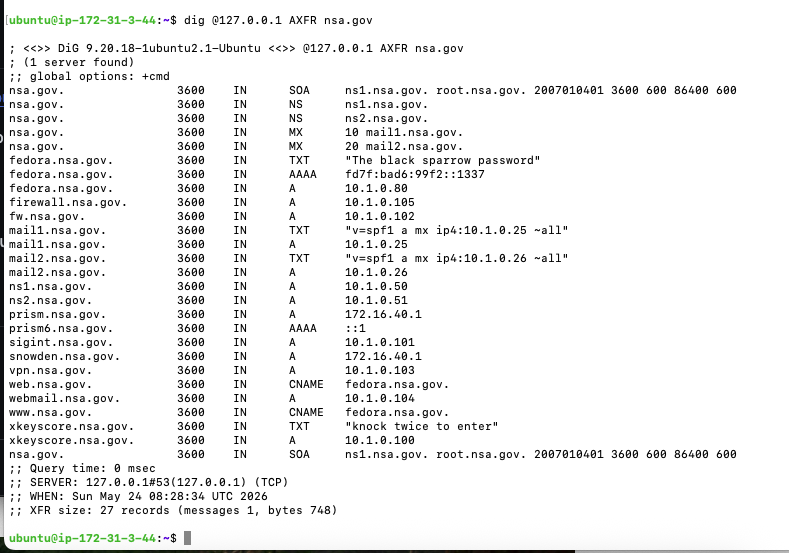

# 🌐 NS-BIND9

**BIND9 DNS server deployment + zone transfer (AXFR) testing lab** — config files, hardening notes and a working `dig` walkthrough.



[](https://ubuntu.com)
[](#)
[](#)

## What this is

A compact, copy-paste lab for standing up **ISC BIND9** on Ubuntu and testing **zone transfers (AXFR)** against it — the same technique real attackers use for DNS reconnaissance. Includes the exact config files used so results are reproducible.

## Quick start

```bash
# 1. add the official ISC PPA (fresher BIND than Ubuntu ships)
sudo add-apt-repository ppa:isc/bind
sudo apt update
```

```bash
# 2. drop in the configs from this repo
sudo cp bind/named.conf.local /etc/bind/
sudo cp bind/named /etc/default/named     # forces IPv4-only
sudo systemctl restart named
```

```bash
# 3. test an AXFR zone transfer — locally, against your own server
dig @127.0.0.1 AXFR nsa.gov
```

You should see the full zone walk out in one response — that's exactly what attackers look for. Then deny it:

```conf
# in named.conf.local
zone "example.com" {
    type master;
    file "/etc/bind/db.example.com";
    allow-transfer { none; };   # ← kill AXFR
};
```

## Why AXFR matters

An open zone transfer hands an attacker your entire zone — every host, internal names, mail targets — in one request. It is one of the oldest (RFC 1034-era) and still most common DNS misconfigurations found in the wild. This lab shows both sides: how to reproduce it, and how to shut it down.

## License

MIT — use at your own risk. Only run AXFR tests against DNS servers you own or are authorised to test.
