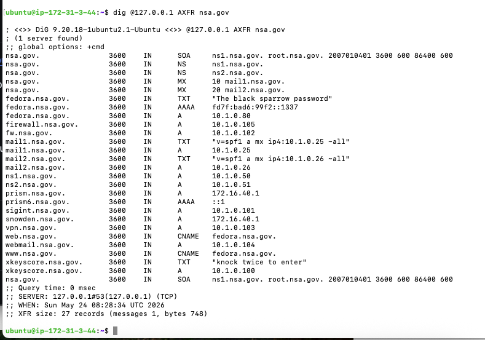

[English](README.md) | **简体中文**

# 🌐 NS-BIND9

**BIND9 DNS 服务器部署 + 区域传送（AXFR）测试实验环境** — 配置文件、加固说明和一份可用的 `dig` 操作演练。



[](https://ubuntu.com)
[](#)
[](#)

## 这是什么

一个精简的、可直接复制粘贴的实验环境，用于在 Ubuntu 上搭建 **ISC BIND9** 并对其测试**区域传送（AXFR）**——这正是真实攻击者进行 DNS 侦察所用的技术。附带了实验中使用的确切配置文件，保证结果可复现。

## 快速开始

```bash
# 1. 添加官方 ISC PPA（比 Ubuntu 自带的 BIND 更新）
sudo add-apt-repository ppa:isc/bind
sudo apt update
```

```bash
# 2. 放入本仓库的配置文件
sudo cp bind/named.conf.local /etc/bind/
sudo cp bind/named /etc/default/named     # 强制仅使用 IPv4
sudo systemctl restart named
```

```bash
# 3. 测试 AXFR 区域传送 — 在本地，针对你自己的服务器
dig @127.0.0.1 AXFR nsa.gov
```

你应该会看到整个区域在一次响应中全部输出——这正是攻击者想要的东西。然后把它关掉：

```conf
# 在 named.conf.local 中
zone "example.com" {
    type master;
    file "/etc/bind/db.example.com";
    allow-transfer { none; };   # ← 禁掉 AXFR
};
```

## 为什么 AXFR 很重要

一个开放的区域传送会在一次请求中把整个区域交给攻击者——每一台主机、内部命名、邮件目标，一个不落。它是最古老（RFC 1034 时代）且至今在野外仍最常见的 DNS 错误配置之一。本实验展示两面：如何复现它，以及如何关闭它。

## 许可证

MIT — 风险自负。只对你拥有或获授权测试的 DNS 服务器运行 AXFR 测试。
